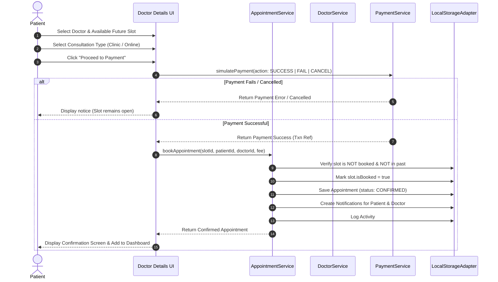
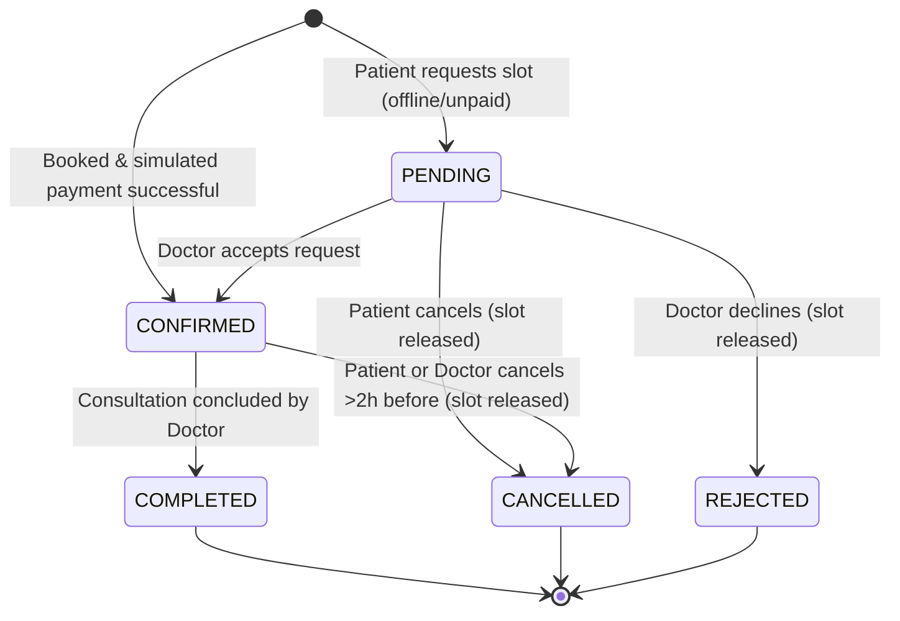
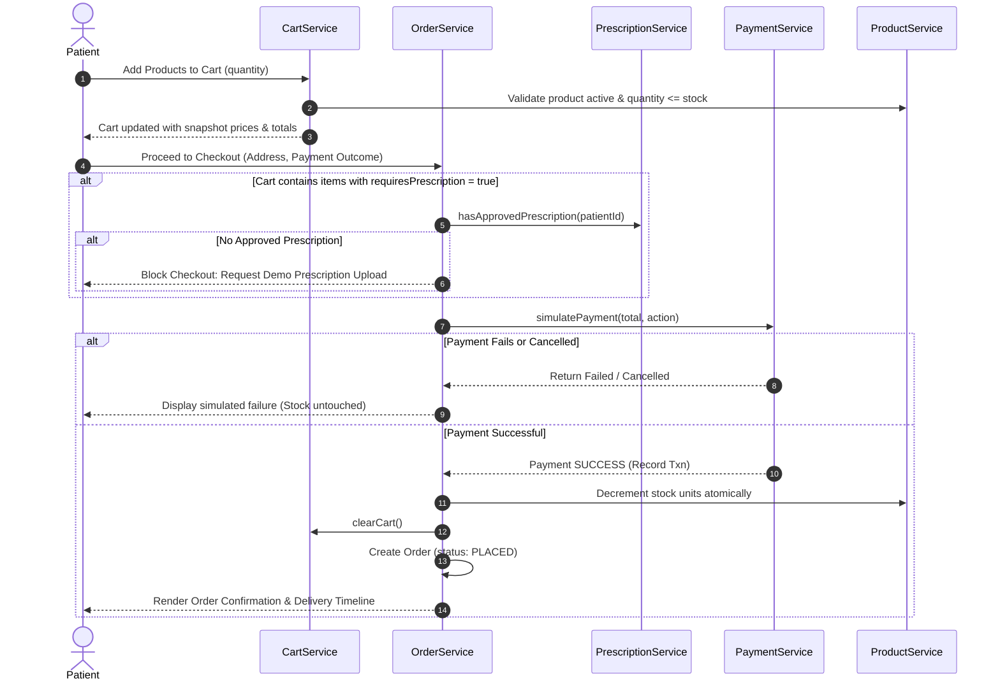
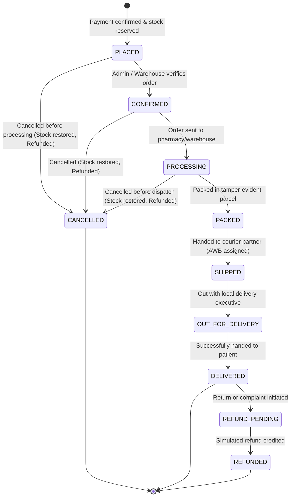

# Business Workflows & State Lifecycles — MediCare

This document maps out the core business workflows and state transition machines powering MediCare.

---

## 1. Doctor Appointment Booking Flow

---

## 2. Appointment Status State Machine

---

## 3. Product Catalog, Cart & Checkout Lifecycle

---

## 4. Controlled Order Fulfillment State Machine

---

## 5. Atomic Rescheduling Workflow

When a patient reschedules an existing appointment:
1. `AppointmentService.rescheduleAppointment(appointmentId, newSlotId, userId)`
2. Validates that `appointment.status` is eligible (`CONFIRMED` or `PENDING`).
3. Validates that `newSlot.isBooked === false`.
4. Atomically within the same service operation:
   - Sets `oldSlot.isBooked = false` (releasing old slot to the doctor's public directory).
   - Sets `newSlot.isBooked = true` (reserving the new slot).
   - Updates `appointment.date`, `appointment.time`, and appends an entry to `appointment.statusHistory`.
   - Dispatches in-app notification to patient.
